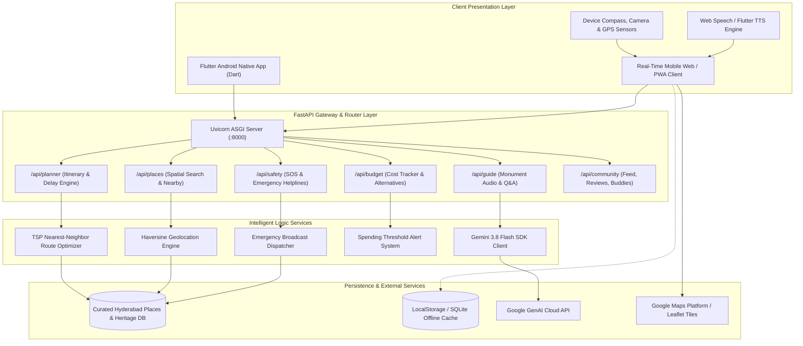
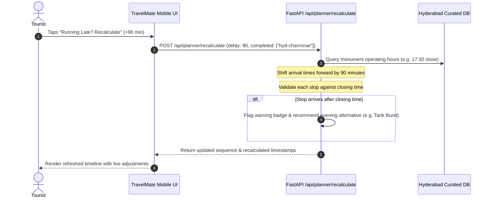

# TravelMate AI – Technical Architecture & Design Document

## 1. High-Level System Architecture

---

## 2. Dynamic Delay Recalculation Flowchart

When a tourist gets delayed at an attraction (e.g. long queues or lingering for photography), TravelMate AI dynamically recalculates their remaining itinerary:

---

## 3. AR Navigation Mathematics (Spherical Trigonometry)

The AR engine computes bearing angle $\theta$ and great-circle distance $d$ from user coordinates $(\phi_1, \lambda_1)$ to target $(\phi_2, \lambda_2)$:

### Bearing Calculation:
$$\Delta\lambda = \lambda_2 - \lambda_1$$
$$y = \sin(\Delta\lambda) \cdot \cos(\phi_2)$$
$$x = \cos(\phi_1) \cdot \sin(\phi_2) - \sin(\phi_1) \cdot \cos(\phi_2) \cdot \cos(\Delta\lambda)$$
$$\theta = \text{atan2}(y, x) \pmod{360^\circ}$$

### Distance (Haversine Formula):
$$a = \sin^2\left(\frac{\Delta\phi}{2}\right) + \cos(\phi_1)\cos(\phi_2)\sin^2\left(\frac{\Delta\lambda}{2}\right)$$
$$d = 2 \cdot R \cdot \text{atan2}(\sqrt{a}, \sqrt{1-a})$$
where $R = 6,371\text{ km}$.
